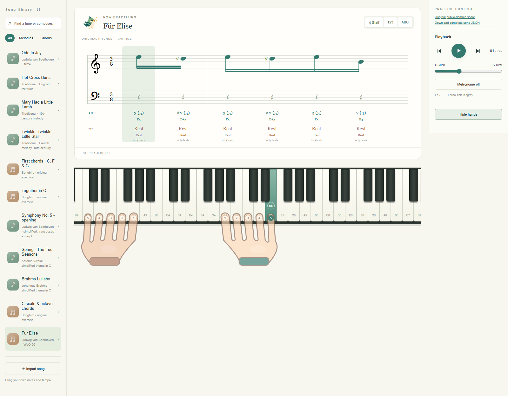

# Songbird

A beginner piano practice app with a cartoon songbird mascot, grand-staff / numbered / letter notation, synthesized audio, timed melodies and chords, and translucent **both-hand silhouettes directly over the piano keys**.

[Open Songbird](https://chris-kc-cheng.github.io/songbird/)



The screenshot is refreshed automatically from the current app on every deployment.

## Run

Use Python 3 and Node 22+ (Node 24 recommended). No dependency installation or build is needed. The browser must support module workers and JSON import attributes.

```sh
npm start
```

The static server listens on port 3000. Click Play to enable browser audio. Piano sound is always enabled; songs stop at the ending and do not loop. Toggle the metronome in Playback to hear it immediately, even with the song paused. It alternates short synthesized wooden tick/tock strikes, with a stronger downbeat. Its separate dry audio path keeps the beat clear over the piano. It continues until toggled off, with clicks that follow the tempo (3/8 uses eighth-note pulses). Space toggles playback outside form controls. Click a white or black key to try a note. Hide hands exposes key labels. Tempo changes pause playback so the next event starts with predictable timing. Für Elise uses this edition's 72 quarter-note BPM by default.

## Included lessons

New simple arrangements of public-domain melodies: Ode to Joy (Beethoven), Hot Cross Buns, Mary Had a Little Lamb, and Twinkle, Twinkle, Little Star. No third-party recording or modern arrangement is included. Original exercises: First chords (C, F and G major triads in both hands) and Together in C (left-hand chord with right-hand melody).

The library also includes beginner melody excerpts of Beethoven's Symphony No. 5, Vivaldi's Spring, and Brahms' Lullaby. These are simplified, transposed themes using natural notes, with automatic fingering; they are not complete original scores.

## Complete Fur Elise

**Fur Elise** in the library contains both piano staves, all sections, both volta repeats and their alternate endings, in original pitch. It has 605 right-hand and 436 left-hand note attacks across 785 input events, covering A1-E7. At the edition's quarter-note tempo of 72 BPM, its 187 beats take about 2 minutes 36 seconds. Runtime frames also include independent note releases.

The public-domain source is [Mutopia-2015/08/18-931](https://www.mutopiaproject.org/ftp/BeethovenLv/WoO59/fur_Elise_WoO59/), typeset by Stelios Samelis from the Breitkopf & Hartel 1888 edition. The original LilyPond and MIDI are bundled in `assets/scores/`, alongside source attribution and the MIDI SHA-256. The right sidebar links the original PDF and downloadable [complete song JSON](songs/fur-elise.json).

Rebuild the musical data with `python scripts/import-fur-elise.py`. This edition's MIDI contains each repeat body once followed by both alternatives; the converter expands those repeats using the bundled score's boundaries. The converter preserves pitches, staff assignments, onset times, note lengths (including grace notes and triplets), and MIDI velocities. Sound uses a six-partial piano-like synthesizer with a fast attack, pitch-dependent release, keyboard stereo panning and a subtle stereo room. Notes ring past release and the ending is allowed to decay. Pause and reset stop the tails. This is synthesized audio rather than recorded piano samples; pedal mechanics and expressive rubato are not simulated.

Long pieces prepare eight opening frames with sixteen frames of lookahead, then calculate upcoming passages in a module worker. If playback catches up, the next passage is calculated on demand. Committed fingerings remain fixed and held notes keep their fingers across passages. Song selection updates the title, highlight and tempo immediately and stops the previous audio. Transport becomes available after the opening passage without waiting for the whole piece. Selecting another song cancels the old worker. Completed plans are cached for instant subsequent switches; switching during playback resumes the new song when ready. The full 88-key keyboard uses fixed 36px white keys, highlights black and white keys, and scrolls to sounding notes. Wider panes reveal more neighboring keys without stretching the keyboard or hands. The score shows more event columns as its pane widens, with consistent note and staff scale. Octave markings keep the practice staff readable; letter labels retain the actual pitches. Finger guidance remains algorithmic rather than Beethoven's or an editor's printed fingering.

## Hand guidance

The hands appear above the keys with numbered fingertips and colored active notes. Thumb = 1, index = 2, middle = 3, ring = 4, little = 5.

The planner supports up to **eight white keys, inclusive** per hand (C4 through C5 is an octave), with at most five simultaneous notes. It searches ordered five-finger layouts across the phrase, keeping up to 48 candidate paths per hand at each event. Costs favor compact five-finger shapes, smaller moves, consistent repeated-note fingers, and conventional triads (right 1-3-5, left 5-3-1). Wider chords may use nonconsecutive finger spacing. Resting hands retain their placement. The drawing uses the generated individual fingertip locations and preserves a connected palm and narrow wrist. Upcoming guidance detects spacing changes as well as shifts.

Ascending/descending, uninterrupted one-octave C-major and A-natural-minor runs use standard thumb-crossing patterns: right ascending 1-2-3-1-2-3-4-5; left ascending 5-4-3-2-1-3-2-1. Other melodies use the general layout search and may reposition instead of crossing. The **C scale & octave chords** exercise demonstrates the scale and sixth, seventh, and octave intervals.

This is a fingering heuristic, not individualized teaching or a simulation of Taubman biomechanics. [The Golandsky Institute](https://www.golandskyinstitute.org/resources/) describes coordinated fingers, hand and forearm movement; an eight-key reach should not be interpreted as an instruction to hold a stretched hand. The app does not model rotation, in/out movement, force or individual hand size. It supports A0-C8 including sharps and flats. Wider-than-octave simultaneous spans, pedal resonance and crossed musical parts remain unsupported. Held notes retain their fingers across intervening attacks. The original [video reference](https://youtu.be/qwY-pDnmSiE) was unavailable to the browser tool; the Institute's published material informed this distinction.

## Import JSON songs

Click **Import song**, select a `.json` file or paste JSON, then Load song. Download links in the dialog provide the schema and a full example. Imports remain in memory until refresh.

- [JSON Schema, draft 2020-12](song.schema.json)
- [Both-hand chord example](songs/first-chords.json)
- [Melody example](songs/ode-to-joy.json)

```json
{
  "version": 1,
  "title": "My first chord",
  "composer": "Your name",
  "category": "chords",
  "tempo": 60,
  "timeSignature": "4/4",
  "events": [{
    "beats": 4,
    "left": {
      "notes": [
        {"pitch": "C3"},
        {"pitch": "E3"},
        {"pitch": "G3"}
      ]
    },
    "right": {
      "notes": [
        {"pitch": "C4"},
        {"pitch": "E4"},
        {"pitch": "G4"}
      ]
    }
  }]
}
```

Events play sequentially. All notes and both hands within one event sound simultaneously for `beats` quarter-note beats. Omit a hand or use `null` for its rest; omit both for a full rest. Repeated notes rearticulate. Supported durations: 0.25, 0.5, 0.75, 1, 1.5, 2, 3, 4, 6. These are version 1 semantics. Version 2 supports independent durations as described below.

Piano pitches A0-C8, including sharps and flats; `C4` is middle C. JSON contains music: `tempo` is speed in BPM, `pitch` determines sound, and `beats` is duration. `left` and `right` identify musical parts. Do not include `finger` or `position`: guidance is generated in memory. Files are limited to 1 MB / 4096 events.

Version 2 adds a required `duration` (quarter-note beats) and optional `velocity` (1-127) on every note, and allows fractional event timing for tuplets and grace notes. `beats` remains the time until the next event, independently of note lengths. For example:

```json
{"version":2,"title":"Independent voices","category":"chords","tempo":72,"timeSignature":"3/8","events":[{"beats":0.25,"left":{"notes":[{"pitch":"A2","duration":1,"velocity":60}]},"right":{"notes":[{"pitch":"E5","duration":0.25,"velocity":80}]}},{"beats":0.75,"right":{"notes":[{"pitch":"D#5","duration":0.25,"velocity":80}]}}]}
```

The left A remains held while the right melody continues. The runtime creates release frames, keeps held-note fingers consistent, and plays each note once. JSON contains no finger numbers or positions.

The staff adapts its visible event count to the pane width. Short notes are beamed by quarter-note beat in /4 meters and by measure in 3/8, with separate groups for each hand, chord stems, bar lines, multiple beam levels and triplet labels. Fur Elise includes its half-beat pickup for grouping. Held display notes use ties. This remains a practice display rather than a complete engraving engine: independent voices within one staff, cross-staff beams and editorial slurs are not modeled.

## Checks

```sh
npm test
```

Unit tests cover pitch tuning, all built-in and example songs, mirrored finger positions, chord spans, invalid imports, overlap, timing, and rests. A DOM/audio playback test runs the entire piece through all 799 display frames, checks black-key highlights and hand geometry, verifies exactly 1,041 synthesized note attacks, and checks the final duration and completion state. Other checks cover source note counts, repeat boundaries, tuplets, pitch range, validation and held-note finger consistency. Visual browser verification was unavailable in this session.

## Layout and installed app

The app always uses the full window width with a wide three-column practice layout. Narrow screens scroll horizontally instead of switching to stacked mode. There is no top bar: Songbird and the notation buttons live in the score pane. Playback and hand controls stay on the right.

The web app manifest uses the existing Songbird mascot in padded 192px and 512px PNG icons, including maskable support and an Apple touch icon. The app opens in standalone landscape mode when installed. A service worker caches the application and bundled songs for offline use after the first successful visit; online requests prefer current files. Serve over HTTPS or localhost for installation and service-worker support. Installation itself uses the browser's install action.

Hands use a connected cartoon silhouette with flat pastel colors, bold outlines, rounded cuffs and numbered fingertip pads. All white-key contacts, including the short fixed-length thumb, share one depth; black-key contacts sit farther back. The keyboard viewport centers on the active hand positions while key dimensions remain fixed.

The metronome has an independent continuous clock: play, pause, reset, song completion and song selection do not stop or restart its tick/tock cycle. Tempo/meter updates adjust the running clock; only its toggle disables it (or an isolated audio failure).

## GitHub Pages and screenshots

The [Pages workflow](.github/workflows/pages.yml) automatically tests and deploys every push to `main`. Manual runs are also available from the Actions tab; only `main` can deploy.

Set up GitHub Pages once:

1. Open [Settings > Pages](https://github.com/chris-kc-cheng/songbird/settings/pages).
2. Under **Build and deployment > Source**, select **GitHub Actions**. There is no branch or folder selector for this source, and no additional workflow template is needed.
3. Push changes to `main`, then check **Actions > Deploy GitHub Pages**. After the build and deploy jobs succeed, visit [Songbird](https://chris-kc-cheng.github.io/songbird/).

GitHub Actions must be enabled for the repository under **Settings > Actions > General**. The workflow declares its own contents-write, Pages-write and identity-token permissions. Branch protection must allow the generated screenshot bot commit to `main`. For deployments without manual approval, the `github-pages` environment must not require reviewers (Settings > Environments > github-pages).

This setup follows [GitHub's custom Pages workflow instructions](https://docs.github.com/en/pages/getting-started-with-github-pages/configuring-a-publishing-source-for-your-github-pages-site#publishing-with-a-custom-github-actions-workflow).

Every deployment captures the default song in Chromium at 1600 x 1000, saves `assets/screenshots/latest.png`, and commits it when changed so this README shows the current interface. Screenshot commits use the built-in Actions token and do not trigger another deployment. The site artifact includes only public application files.

To update the screenshot locally:

```sh
npm ci
npx playwright install chromium
npm run screenshot
npm run build:pages
```

The screenshot check serves the app under `/songbird/` to verify GitHub Pages asset paths, waits for the keyboard and hands, and fails on browser errors or missing local assets. Keep the latest screenshot in this README whenever the UI changes.
